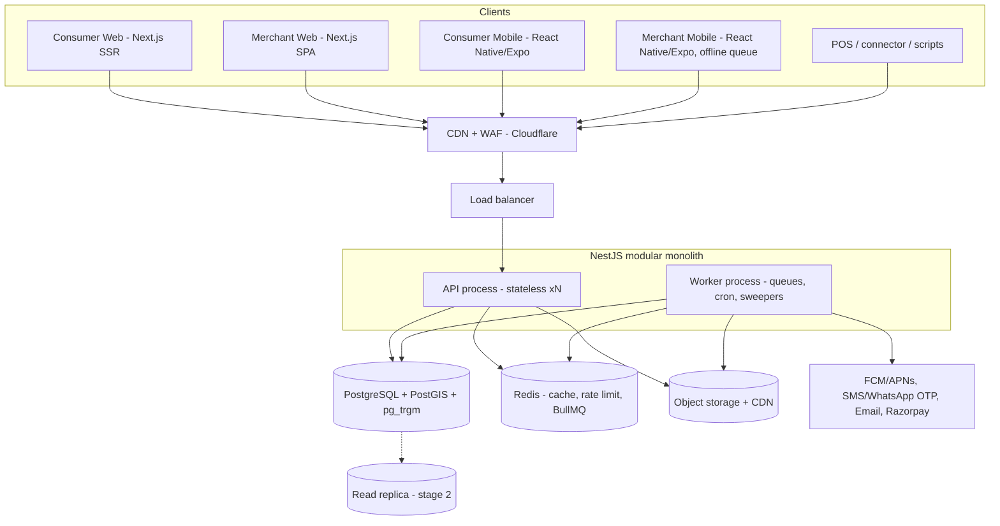

# Backend System Design — Local Commerce & Cloud Inventory Network

Companion to `Local_Commerce_Cloud_Inventory_Platform_Detailed_Concept (10).md` (referred to as **CD**). Terse by design: reference sections by number instead of re-pasting.

**Scope:** one backend serving 4 clients — consumer web, merchant web, consumer mobile (iOS+Android), merchant mobile (iOS+Android). Low-cost, single-region India.

**Functional requirements:** `docs/FRD.md` (the main document for review).
**Related docs (`docs/`):** `01_Exception_Handling.md` · `02_Reservations_Payments_Delivery.md` · `03_Decisions_Log.md` · `04_Operations_Runbooks.md` — see `docs/README.md`. Where this file conflicts with those, **those win** (they are newer).

---

## Part A — Suggestions on the concept

**Strong already:** ledger-first inventory, honest freshness labels, merchant-controlled publishing, modular monolith, phased roadmap.

| # | Gap / change | Why |
|---|---|---|
| 1 | Make the **lowest-effort stock update path** an MVP feature: barcode-scan "sell/receive", bulk CSV, one-tap in/out-of-stock toggle. Defer POS connectors (Tally/Busy/Marg…) to post-MVP. | Biggest risk is stale stock, not tech. Stock stays accurate only if sales get captured cheaply. |
| 2 | Public API exposes **status + freshness only**, never exact quantity (resolves CD §19.7). | Privacy, competitive safety, less stale-number blame. |
| 3 | **Updated (D-03, deferred by D-19):** reservations are a Premium, merchant opt-in feature with paid modes (future release): token+pickup, full+pickup, full+delivery. Manual confirm by default. Details in `docs/02`. | Paying reduces no-shows; merchants earn from premium. |
| 4 | Launch with **1–2 low-compliance categories** (hardware, stationery, electronics accessories). Pharmacy behind a category feature flag, off. | Legal/safety risk (CD §13.1). |
| 5 | **Offline-first merchant mobile**: local op queue, client UUIDs, idempotent batch sync. | Weak connectivity in shops; CD covers server idempotency but not client behaviour. |
| 6 | **Anonymous search**; phone-OTP only when reserving. | Lower drop-off, less PII (DPDP Act 2023). |
| 7 | Search needs **Hindi/regional + transliteration** (e.g. "pankha" ↔ "पंखा" ↔ "fan"). | Core relevance in India. |
| 8 | Add missing specs: API versioning + **force-upgrade** for old mobile apps, GST/invoice scope (don't build accounting), subscription billing (Razorpay), DPDP consent + retention. | Not in CD. |
| 9 | Price is the most-stale field → show only with timestamp; auto-hide after N days. | Trust. |
| 10 | Freshness TTL per category/merchant-source (e.g. native-scan 24h, CSV 72h, manual 7d) decides "Available" vs "Check with shop" (CD §19.8). | Concrete rule. |

---

## Part B — Architecture

### B1. Principles
1. **One API, many clients.** Versioned REST (`/v1`) + OpenAPI → generated typed clients (web + mobile).
2. **Modular monolith** (TypeScript / NestJS), one deployable, two process types (API, Worker). Split later only on evidence.
3. **Postgres is the source of truth**; search/cache/public listing are rebuildable projections.
4. **Availability label computed server-side only** so all 4 clients agree.
5. REST over GraphQL/gRPC: cacheable public GETs, simple codegen, cheaper to run and to build.

### B2. System diagram



### B3. API surfaces (same deployable, separated by prefix + auth scope)

| Prefix | Used by | Auth | Notes |
|---|---|---|---|
| `/v1/public/*` | consumer web/mobile | none | search, shop/branch, listing detail; CDN-cacheable, ETag, rate-limited by IP |
| `/v1/consumer/*` | consumer web/mobile | phone-OTP session | reservations, profile, favourites, report-inaccuracy |
| `/v1/merchant/*` | merchant web/mobile | org/branch-scoped RBAC | catalogue, inventory, purchasing, reports, publication, integrations, sync batch |
| `/v1/ingest/*` | POS/connectors | API key + HMAC | idempotent stock events, snapshots |
| `/v1/admin/*` | platform staff | SSO + IP-restricted | moderation, support, later |
| `/v1/meta/*` | all | none | `min-versions` (force-upgrade), category schemas, feature flags |

**Conventions (all clients):** cursor pagination · `Idempotency-Key` on mutating POSTs · RFC 7807 errors with stable error codes · `X-Client-Version` header · ETag/`If-None-Match` on public GETs · response shaping per surface (public never returns cost/qty/supplier) · deprecation window ≥ 12 months for mobile-facing fields · realtime = push notifications (FCM) + short polling/SSE; no WebSocket infra initially.

### B4. Modules (bounded contexts)

Maps to CD §7.2. Each module owns its tables; cross-module writes go through service interfaces or **outbox events** (no cross-module write joins).

| Module | Owns | Key rules |
|---|---|---|
| Identity & Tenancy | user, org, branch, membership, role, session, device | RBAC = role × branch scope; RLS on `org_id` |
| Catalogue | product, product_identifier, category, attribute schema | JSON-schema-validated attributes; dedupe/merge workflow |
| Inventory Ledger | stock_movement (append-only), inventory_balance, batch/lot (optional) | single txn per mutation; idempotent by (org, source, event_id) |
| Listing / Publication | merchant_listing, publication settings, `public_listing` projection | merchant controls branch/product/price/status visibility |
| Search | queries over `public_listing` | geo + text + ranking; no private data |
| Reservation — *deferred* | reservation, reservation_item, policy snapshot, state machine | atomic stock hold, deadlines, release; premium-gated (`docs/02` §4) |
| Payments — *deferred* (Release 1 has subscription billing only, in the Billing module) | payment, refund, transfer, payment_event, money_ledger | Razorpay + Route, webhook dedup, reconciler, on-hold settlement (`docs/02` §2, §7) |
| Delivery — *deferred* | delivery, assignments, OTP proof | merchant-own delivery, radius check, retries (`docs/02` §8 D1–D6) |
| Integration / Sync | connection, sync_job, sync_row, sync_error, review queue | staging, mapping, conflict policy, source-of-truth per field |
| Purchasing | supplier, PO, GRN, returns | feeds ledger via receipts |
| Notification | notification, device tokens, prefs | FCM, SMS/WhatsApp, email; delivery log |
| Billing | plan, subscription, invoice (platform's own) | Razorpay; entitlements gate features |
| Reporting | read models/materialized views | run on replica / async |
| Audit | audit_event | sensitive actions, support access |

### B5. Data design (Postgres)

- **Tenancy:** shared DB; `org_id` on every tenant table; **Row-Level Security** (`SET LOCAL app.org_id`) as defence-in-depth beside app-layer RBAC; cross-tenant authz tests in CI.
- **Ledger:** `stock_movement(id, org_id, branch_id, product_id, qty_delta numeric(14,3), unit, reason, source, source_event_id, source_ts, ingested_at, actor_id)` — append-only, UNIQUE(org_id, source, source_event_id), partitioned monthly.
- **Balance:** `inventory_balance(org_id, branch_id, product_id, on_hand, reserved, unsellable, version, last_verified_at)` — updated in the same txn as the movement.
- **Public projection:** `public_listing(branch_id, product_id, org_id, geo, tsv, status, price_paise?, last_verified_at, …)` — GIST(geo), GIN(tsv), trigram index; rebuilt by worker from outbox events. Contains only merchant-approved fields.
- **Money** = integer paise. **Quantity** = numeric(14,3). **Time** = `timestamptz` UTC + branch timezone.
- **Category-specific attributes:** `product.attrs JSONB` validated against a per-category JSON schema served by `/v1/meta`.
- **Supporting tables:** outbox, idempotency_key, audit_event, notification, device, sync_*.

### B6. Search (MVP = Postgres only)
`tsvector` + `pg_trgm` (typos) + synonym/transliteration table + PostGIS `ST_DWithin`. Rank = text match × distance decay × availability confidence × freshness decay (no paid-only ranking, CD §5.4). Hot queries cached in Redis (short TTL, geohash-bucketed keys). **Upgrade trigger:** > ~1M listings or relevance limits → Meilisearch/OpenSearch fed by the same outbox events.

### B7. Auth
- Merchant: email/phone + password or OTP; JWT access (15 min) + rotating refresh; owner MFA. Consumer: phone OTP.
- Web: httpOnly cookies + CSRF protection. Mobile: device-bound refresh token in secure storage.
- Recommended: managed OTP provider + own session/RBAC layer (cheapest to run, avoids auth-vendor lock-in for permissions).
- Integration keys: hashed at rest, scoped, rotatable, per-connection.

### B8. Critical flows

**1. Stock mutation (any source)**
```mermaid
sequenceDiagram
  participant C as Client/Connector
  participant A as API
  participant D as Postgres
  participant W as Worker
  C->>A: POST movement (Idempotency-Key)
  A->>A: authn, RBAC, validate
  A->>D: BEGIN; insert stock_movement; update balance (row lock, version); insert outbox; COMMIT
  A-->>C: 201 (or replay of prior result)
  W->>D: read outbox
  W->>D: update public_listing (status, last_verified_at)
  W->>W: invalidate cache, notify low-stock
```

**2. Reservation (atomic)** — *superseded by the paid flow in `docs/02` §5; the stock-hold logic below still applies.*
```mermaid
sequenceDiagram
  participant U as Consumer
  participant A as API
  participant D as Postgres
  participant M as Merchant app
  U->>A: POST reservation (OTP session, Idempotency-Key)
  A->>D: BEGIN; SELECT balance FOR UPDATE; check on_hand-reserved-unsellable >= qty; insert reservation REQUESTED; reserved += qty; outbox; COMMIT
  A-->>U: 202 pending, expires_at
  D-->>M: push via outbox -> worker -> FCM
  M->>A: confirm / decline
  A->>D: state transition (declined => release reserved)
  Note over A,D: Sweeper job releases expired reservations (DB expires_at is authoritative; Redis timer is optimisation)
```
State machine: REQUESTED → CONFIRMED | DECLINED | CANCELLED; CONFIRMED → FULFILLED | CANCELLED | EXPIRED (as CD §9.2), enforced in one domain service only.

**3. Offline merchant sync (mobile)**
Client stores ops locally with `client_uuid` + `client_ts`. On reconnect: `POST /v1/merchant/sync/batch` (ordered ops). Server applies each idempotently, returns per-op result (applied / duplicate / rejected / needs-review). Ledger never rewritten; corrections are compensating movements. Client pulls deltas via `GET …/changes?since=<cursor>`.

**4. Bulk import (CD §8, App. A)**
Presigned upload → job → validate schema → stage rows → map products/branches → ambiguous → review queue → apply idempotent events → reconcile totals → report.

**5. Public search**
CDN/Redis → API → PG on `public_listing` → compute label from `last_verified_at` vs category TTL → response with freshness metadata.

**6. Publication control**
Merchant changes visibility → outbox → worker upserts/deletes `public_listing` → cache purge. Private data never leaves ledger modules.

### B9. Client ↔ backend map

| Client | Surfaces | Special backend support |
|---|---|---|
| Consumer web (Next.js SSR) | public, consumer | SEO pages for shop/product; cacheable endpoints |
| Consumer mobile (Expo) | public, consumer, meta | FCM push, min-version check, location permission fallback to manual area |
| Merchant web (Next.js) | merchant | reports, imports, bulk edits, web-only admin-heavy flows |
| Merchant mobile (Expo) | merchant, meta | offline queue + sync batch, barcode scan, push for reservations, image upload via presigned URL |

### B10. Notifications
Outbox → worker → FCM (covers Android + APNs), SMS/WhatsApp (OTP, reservation updates), email (reports, sync failures). Per-user preferences; delivery log; retry with backoff; dead-letter table.

### B11. Security & privacy (maps CD §12, App. B)
WAF + TLS; secrets manager; encrypted DB/backups; encrypted integration credentials; upload limits + type checks; rate limits on search/auth/reservation; audit_event for sensitive actions; time-boxed, logged support impersonation; PII minimisation; reservation-contact retention job; DPDP consent records; no PII in logs/analytics.

### B12. Deployment & cost (India, single region, e.g. AWS ap-south-1)

| Stage | Setup |
|---|---|
| **1 – Pilot** | 1 container service (API + Worker as 2 tasks) or one small VM with Docker; managed Postgres with PITR backups; Redis (managed small or co-located); S3 + CDN; GitHub Actions CI/CD. |
| **2 – Growth** | Autoscale API, separate worker pool, PG read replica for search/reports, dedicated search engine if needed. |
| **3 – Scale** | Extract Search and Ingest as services; multi-AZ; multi-region only on evidence. |

Observability: structured logs + OpenTelemetry → Grafana/Loki or CloudWatch + Sentry. Dashboards/SLOs: API p95, search p95, reservation failure rate, sync lag, freshness distribution, duplicate-event rate. Environments: dev / staging / prod. Migrations via versioned tool (Prisma/Drizzle/Flyway), expand-then-contract.

### B13. Capacity sanity
Pilot < 500 merchants; even at 50k SKUs each the balance table is bounded in tens of millions rows — well within one Postgres instance with partitioned ledger and proper indexes. Public search is read-heavy (~50:1): cache + replica come before any new technology.

### B14. Repo layout (monorepo)
```
apps/api            NestJS (modules/*), worker entrypoint
apps/web-consumer   Next.js SSR
apps/web-merchant   Next.js
apps/mobile         Expo; two app variants (consumer, merchant)
packages/api-client generated from OpenAPI
packages/schemas    Zod / shared types, category attribute schemas
packages/ui         shared components
infra/              IaC, CI
```

### B15. Build order (maps CD §16)
- **P1:** identity/tenancy → catalogue → ledger+balance → CSV import → merchant web + mobile (scan & adjust) → reports → publication settings.
- **P2:** public_listing + geo search → consumer web + mobile.
- **P3:** offline sync hardening + sync health dashboard + 1 connector + push notifications. (Reservations deferred, D-19.)
- **P4:** transfers, more integrations, billing/entitlements, search-engine upgrade, batch/expiry.

---

## Part C — Recommended defaults for CD §19 open decisions

| CD §19 | Recommendation |
|---|---|
| 1 Pilot locality | One dense market/locality in a single city; decide after merchant interviews |
| 2 Categories | Hardware / stationery / electronics accessories first; pharmacy flagged off |
| 3 Web vs mobile | Merchant: mobile + web; consumer: web (SEO) + mobile — all share one API |
| 4 Common systems | Discover in Phase 0; start with CSV/Excel only |
| 5 Authority | Platform = reservations & publication; POS = sales (when connected); per-field map per integration |
| 6 Reservations | Premium, paid modes, manual confirm default (D-03, `docs/02`) |
| 7 Exact qty public | No — status + freshness only |
| 8 Freshness | Per-source TTL (native 24h / CSV 72h / manual 7d), tunable per category |
| 9–10 Pricing/support | Validate in Phase 0; paid onboarding for migration |
| 11 Legal | Pharmacy review required before enablement; DPDP review before launch |
| 12 Metrics | CD §17 + reservation confirm rate + % listings fresher than TTL |

## Token-economy notes
- Treat this file + OpenAPI spec as the contract. For each coding session load **one module** + its OpenAPI slice, not the whole concept doc.
- Reference sections (`CD §9.3`, `B8.2`) instead of restating them.
- Build and test module-by-module; generate clients from OpenAPI instead of hand-writing them.
