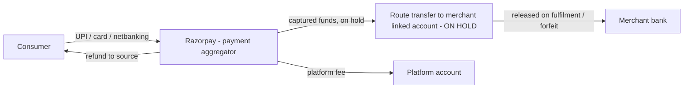
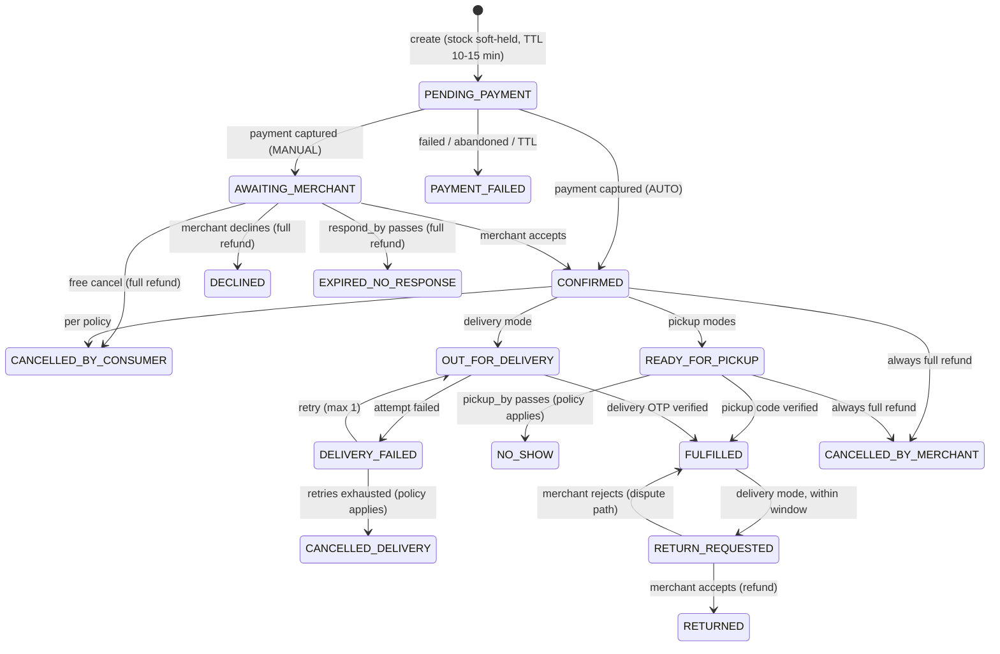

# 02 — Reservations, Payments & Delivery (Premium B2B feature)

> **STATUS: DEFERRED (decided 2026-10-19).** Not in Release 1 or 2. Kept as the reference design for a future release (see `FRD.md` §4 release plan, FR-RES). Don't implement anything from this file until the founder re-opens it. Legal and finance research for this feature (payment aggregator, GST TCS s.52, TDS s.194-O, refund rules) must be redone when it's re-opened.

Load this file only when working on reservations, payments, delivery, refunds or settlements. Main design: `../Backend_System_Design.md`. Exceptions summary: `01_Exception_Handling.md` §5–§6.

---

## 1. Feature summary

Reservations are **opt-in per merchant** and part of the **Premium plan**. The Free plan has discovery, contact and directions only.

| Mode | Consumer pays online | Fulfilment | Balance due |
|---|---|---|---|
| `TOKEN_PICKUP` | Token amount set by the merchant | Consumer collects at the shop | Remainder paid at the shop (off-platform at launch) |
| `FULL_PICKUP` | Full price | Consumer collects at the shop | None |
| `FULL_DELIVERY` | Full price + delivery fee | Merchant delivers (merchant's own staff) | None |

Merchant settings (per branch, overridable per product/category):
- Enabled modes; `accepting_reservations` toggle (a quick pause switch).
- Token rule: fixed ₹ or % of price, with min/max. Platform cap: token ≤ 50% of price (configurable).
- Hold duration for pickup (e.g. 2h, max 24h), max quantity per item, max items per reservation.
- Confirmation mode: `MANUAL` (default) or `AUTO` (allowed only for platform-native stock with fresh data).
- Cancellation policy: chosen from **presets** (never free text, so the rules can be enforced): `FLEXIBLE` or `STRICT` (§6).
- Delivery: radius (km, PostGIS check), fee (flat or by distance band), minimum order value, delivery hours/slots.

Preconditions to enable paid modes:
1. Premium entitlement is active.
2. Merchant KYC is done and the Razorpay linked account is **activated** (Route).
3. Price is published for the products that get reservations (an amount can't be charged without a price).
4. Branch hours are set (reservations are allowed only while the branch is open, D-12).

Scope rules (launch):
- One reservation = **one branch** (no multi-shop cart).
- **All-or-nothing per item** (no partial quantity confirmation).
- No COD, no third-party delivery partners, no on-platform payment of the pickup remainder (all later).

---

## 2. Money flow (India)



- **Funds never sit in the platform's own bank account**. Razorpay (a licensed payment aggregator) plus Route linked accounts hold them, so the platform doesn't need its own PA licence. Transfers are created `on_hold` and **released** only on fulfilment or a forfeit event.
- The platform fee (commission %) and the payment-gateway fee policy are configurable per plan.
- **Tax (confirm with a CA before launch):** as an e-commerce operator collecting payment for merchants, the platform likely has to collect **GST TCS (s.52 CGST Act, currently 0.5%)** and **income-tax TDS (s.194-O, currently 0.1%)** on payouts, and file returns for them. The design keeps a per-transaction tax-withholding record in the payments ledger.
- All amounts are integer **paise** and computed **server-side only**. The client never sends an amount.

---

## 3. Data model (conceptual)

| Entity | Key fields |
|---|---|
| `reservation` | id, org_id, branch_id, consumer_id, mode, status, confirmation_mode, policy_snapshot (jsonb), hold_expires_at, respond_by, pickup_by, pickup_code_hash, delivery_address_id, delivery_fee_paise, version |
| `reservation_item` | reservation_id, product_id, qty, unit, unit_price_paise (snapshot), token_paise |
| `payment` | id, reservation_id, provider_order_id, provider_payment_id, amount_paise, status, method, captured_at, idempotency_key |
| `refund` | id, payment_id, amount_paise, reason, status, provider_refund_id, attempts |
| `transfer` | id, payment_id, linked_account_id, amount_paise, status (`on_hold`/`released`/`reversed`), release_at |
| `payment_event` | provider event id (UNIQUE), type, payload hash, received_at, processed_at — webhook dedup |
| `delivery` | reservation_id, assignee_user_id, status, attempts, otp_hash, proof (photo key), failure_reason |
| `money_ledger` | double-entry rows per money movement (consumer→escrow, escrow→merchant, fee, tax, refund) for reconciliation |
| `consumer_strike` | consumer_id, reason (no_show / chargeback_abuse), created_at |

**Invariants** (checked by the reconciliation jobs in `04_Operations_Runbooks.md`):
- `inventory_balance.reserved` = sum of qty over active reservation items.
- Sum of captured payments = released transfers + on-hold transfers + refunds + platform fee + tax withheld (per day, against the Razorpay settlement report).

---

## 4. State machines

Reservation status and payment status are **separate** state machines, linked by events.

### 4.1 Reservation



Rules:
- Every transition is a conditional update (`WHERE status = :expected AND version = :v`). The loser gets `409 RESERVATION_STATE_CONFLICT`.
- All transitions live in **one domain service**. Each writes the audit event, outbox event and stock/money effects in the same DB transaction.
- Deadlines (`hold_expires_at`, `respond_by`, `pickup_by`) are stored in the DB and checked on every read ("lazy expiry"). A sweeper job applies them on schedule. Redis timers are only an optimisation.

### 4.2 Payment
`CREATED → AUTHORIZED → CAPTURED → (PARTIALLY_)REFUNDED`, or `CREATED → FAILED`. Auto-capture is on. Payment truth comes **only** from signature-verified webhooks, or a server-side fetch from the Razorpay API. The client "success" callback is just a hint to start polling.

### 4.3 Stock effects per transition
| Transition | Inventory effect (same txn) |
|---|---|
| create | `reserved += qty` (row lock; fails if sellable < qty → `409 INSUFFICIENT_STOCK` + alternatives) |
| PAYMENT_FAILED / DECLINED / EXPIRED_* / CANCELLED_* / NO_SHOW | `reserved -= qty` |
| FULFILLED | `reserved -= qty` and a `sale` movement `on_hand -= qty` (ref = reservation) |
| RETURNED | `customer_return` movement (into `on_hand`, or `unsellable` if damaged) |

For **externally managed stock** (POS is the source of truth), the hold is advisory: confirmation is always `MANUAL`, and the merchant confirms after checking the shelf.

---

## 5. Main flow (token / full pickup)

```mermaid
sequenceDiagram
  participant U as Consumer app
  participant A as API
  participant D as Postgres
  participant R as Razorpay
  participant W as Worker
  participant M as Merchant app
  U->>A: POST /consumer/reservations (Idempotency-Key, items, mode)
  A->>D: txn: lock balance, check sellable, reserved+=qty, reservation PENDING_PAYMENT, payment CREATED, amounts from server prices
  A->>R: create order (amount, transfer on_hold to linked account)
  A-->>U: order_id, amount, hold_expires_at
  U->>R: checkout (UPI/card)
  R-->>A: webhook payment.captured (signed)
  A->>D: dedup event id; payment CAPTURED; reservation AWAITING_MERCHANT; outbox
  W->>M: push + SMS fallback "New reservation, respond by HH:MM"
  M->>A: accept
  A->>D: CONFIRMED -> READY_FOR_PICKUP, pickup_by set, pickup code issued
  W->>U: push/SMS with pickup code
  M->>A: verify pickup code at counter
  A->>D: FULFILLED; sale movement; release transfer
```

Delivery mode is the same up to CONFIRMED. Then: the merchant assigns a staff member with the `delivery` role → OUT_FOR_DELIVERY (the consumer sees status; live GPS tracking comes later) → the staff member enters the consumer's **delivery OTP** → FULFILLED → transfer released.

---

## 6. Cancellation, no-show and refund policy

| Event | FLEXIBLE preset | STRICT preset |
|---|---|---|
| Consumer cancels before merchant confirms | 100% refund | 100% refund |
| Consumer cancels after confirm, pickup modes | 100% refund if > 1h before `pickup_by`; else token forfeited | Token forfeited (FULL modes: refund minus token-equivalent %) |
| Consumer cancels after OUT_FOR_DELIVERY | Refund minus delivery fee | Refund minus delivery fee |
| **No-show** (didn't collect by `pickup_by`) | Token forfeited to merchant; FULL modes: refund minus forfeit % | Same |
| Merchant declines / doesn't respond / cancels | **Always 100% refund** | **Always 100% refund** |
| Delivery failed (consumer unreachable, 2 attempts) | Refund minus delivery fee | Refund minus delivery fee |
| Item damaged / wrong item (delivery) | Return → 100% refund | Same |

- The policy is **snapshotted onto the reservation** when it's created, so later merchant changes don't affect existing reservations.
- **No-show abuse:** 3 no-shows in 30 days → the consumer can't reserve for 14 days (the strike record expires automatically). Merchants can also block a phone number for their own shop.
- **Merchant reliability:** declines, non-responses and merchant cancellations feed a responsiveness score. A low score lowers search ranking and triggers a support nudge. Repeated merchant cancellations after confirm can suspend the reservation feature.
- Refunds always go **to the original payment source** via Razorpay. The platform never collects bank details.

---

## 7. Settlement (Route transfers)

- Transfers are created at order time with `on_hold = true`.
- **Release** on FULFILLED (pickup code or delivery OTP verified), or on a forfeit event (NO_SHOW / late cancel: only the forfeited part).
- **Fulfilled without a code** (consumer forgot it): the merchant can mark it fulfilled with a reason. The release is then delayed (T+3 days) so the consumer has time to dispute.
- **Return window** for delivered items (e.g. 48h) → release after the window, or immediately if the merchant's category is non-returnable (configurable).
- Refund after release → **transfer reversal**. If that fails, the amount is offset against the merchant's next payouts (merchant balance can go negative and is shown in the merchant's payouts screen).

---

## 8. Exception catalogue — payments, reservations, delivery

| # | Case | Handling |
|---|---|---|
| P1 | Payment webhook is late or never arrives | Client polls `GET /reservations/{id}`. Worker reconciler fetches the order from the Razorpay API at T+2, +5 and +15 min for every PENDING_PAYMENT reservation. |
| P2 | Duplicate / out-of-order webhooks | UNIQUE provider event id in `payment_event`. Transitions are monotonic (never move backwards). An unknown order is logged and alerted. |
| P3 | Forged webhook | HMAC signature verified; reject and alert. Amounts are cross-checked against our order. |
| P4 | Payment captured **after** the soft hold expired | Try to re-hold the stock. If it succeeds, continue as normal. If not → auto full refund + "Sorry, sold out" + alternatives. |
| P5 | UPI shows "pending" for minutes | Extend PENDING_PAYMENT up to the provider's pending window (keep holding the stock for that time). Show "Payment processing" in the UI. |
| P6 | Consumer closes the app during payment | Reservation stays PENDING_PAYMENT. The reconciler resolves it (P1). The app resumes the status on next open. |
| P7 | Double tap / retry creates two orders | Idempotency-Key on create returns the same reservation and order. |
| P8 | Client tampers with the amount | The amount is computed server-side from the price snapshot. Client amount fields are ignored. |
| P9 | Price changed between search and checkout | Create uses the current price and shows it before payment. The snapshot is locked once the order is created. |
| P10 | Refund API fails | Retry with backoff (idempotent via our refund id). After 5 failures → ops queue + alert. The consumer sees "Refund initiated, reference X". |
| P11 | Refund takes days (bank side) | Show the expected window per method (UPI ≈ instant–2 days, card 5–7). Store the refund ARN/RRN for support. |
| P12 | Chargeback / dispute | `dispute.created` webhook → attach evidence (pickup/delivery OTP log, timestamps, photo). If funds were already released → reversal or offset (§7). |
| P13 | Merchant's linked account is suspended or KYC is pending | Paid modes are automatically disabled for that merchant. Existing reservations: those not yet confirmed are refunded; confirmed ones proceed with the transfer held until resolved. |
| P14 | Razorpay is down | Circuit breaker: hide the "Reserve" button and show "Reservations temporarily unavailable". Discovery is unaffected. |
| P15 | Daily settlement mismatch | Reconciliation job vs the Razorpay settlement report → mismatch alert. Funds are never auto-corrected; ops resolve them. |
| R1 | Two consumers want the last unit | Row lock at create. The second gets `409 INSUFFICIENT_STOCK` before paying (nobody pays for a lost race, except P4). |
| R2 | Merchant doesn't respond by `respond_by` (default 30 min, within open hours) | EXPIRED_NO_RESPONSE → full refund, stock released, consumer shown alternatives, merchant score down. |
| R3 | Reservation attempted while the branch is closed or paused | Blocked at create (`422 BRANCH_NOT_ACCEPTING`). The UI shows the next opening time. |
| R4 | Merchant accepts after expiry / consumer cancels while merchant accepts | Conditional update: the first transition wins; the other gets 409 and the UI refreshes. |
| R5 | Item sold at the counter after confirm | Platform stock: `reserved` stops it being sold (the counter sale screen warns). External POS stock: the merchant must cancel → full refund + score penalty. |
| R6 | Consumer arrives late (after `pickup_by`) | NO_SHOW applies. The merchant may still sell to them in person (off-platform). An "extend pickup" action is available to the merchant before expiry. |
| R7 | Consumer lost the pickup code | Resend via app/SMS (rate-limited). Or the merchant uses "fulfilled without code" (§7, delayed release). |
| R8 | Merchant app offline when a reservation arrives | SMS/WhatsApp fallback. Respond via the web dashboard or a deep link. Otherwise R2. |
| R9 | Spam / fake reservations | OTP login, payment required (natural deterrent), max 3 active reservations per consumer, device fingerprint, merchant block list. |
| R10 | Product unpublished / branch closes after reservation | Active reservations are honoured or must be cancelled by the merchant (full refund). They are never silently dropped. |
| R11 | Stock correction (count) reduces on_hand below reserved | Discrepancy alert to the merchant: "X reserved units not available — confirm or cancel reservations". |
| D1 | Address outside the delivery radius | Rejected at create (PostGIS check) with `422 OUT_OF_DELIVERY_AREA`. |
| D2 | Consumer unreachable / not home | Mark DELIVERY_FAILED (reason + timestamp + optional photo). 1 retry, then CANCELLED_DELIVERY (refund minus delivery fee). Item returns to stock via a `customer_return`-type movement. |
| D3 | Wrong or damaged item | RETURN_REQUESTED within the window, with a photo. The merchant accepts → refund; rejects → dispute to platform support. |
| D4 | Delivery staff can't enter the OTP (no network) | The merchant app accepts the OTP offline (hash cached with the delivery). The sync batch completes FULFILLED later; the transfer is released after sync. |
| D5 | Delivery staff leaves mid-delivery / reassignment | The merchant reassigns. Every assignment change is audited. |
| D6 | Consumer disputes "not delivered" though the OTP was used | OTP log + timestamp + location of the delivery staff device (if permitted) = evidence. Platform support decides. |

---

## 9. Required merchant/consumer UI support (backend implications)

- Merchant: reservation inbox with a respond-by countdown, accept/decline with reason, pickup-code verify, assign delivery, extend pickup, payouts and reconciliation screen, KYC status.
- Consumer: payment status (incl. "processing"), refund status + reference, pickup code, delivery tracking states, cancel with a policy preview ("You'll get ₹X back").
- Every money-affecting action shows a **policy preview computed server-side** (`GET /reservations/{id}/cancel-preview`).
