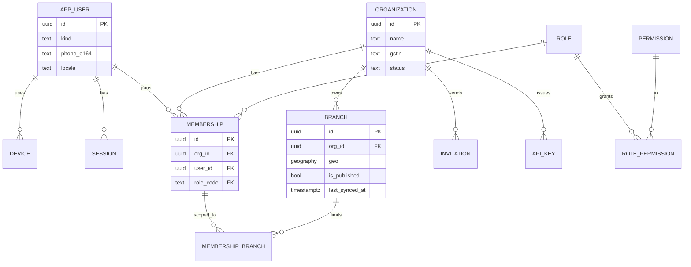
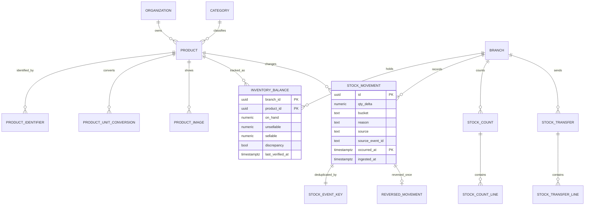
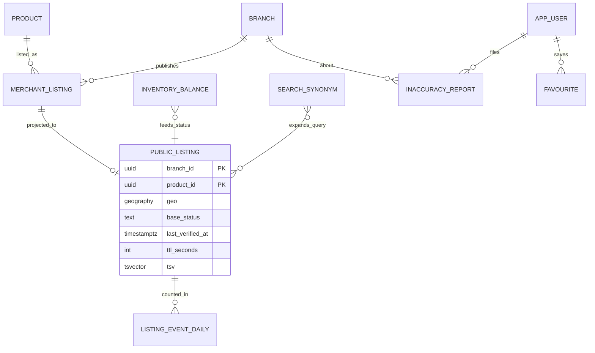
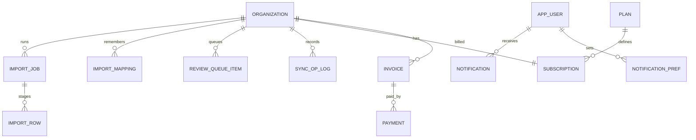

# 05 — Database Schema & ERD (Release 1)

Source of truth: `codebase/db/migrations/*.sql` (PostgreSQL 17 + PostGIS). This page explains it. Verified by `codebase/db/tests/schema.test.mjs` (25 tests, all passing; see §6).

## 1. Migrations
| File | Contents | FRD areas |
|---|---|---|
| `0001_core.sql` | Extensions, app role, request-context helpers, RLS helper, outbox, idempotency keys, audit log, feature flags | FR-AUD, FR-ADM-06 |
| `0002_identity.sql` | Users, devices, sessions, OTP, organisations, branches, roles/permissions, memberships, invitations, API keys | FR-IAM, FR-ORG |
| `0003_catalogue_inventory.sql` | Categories, products, identifiers, **ledger**, balances, counts, transfers, ledger functions | FR-CAT, FR-INV |
| `0004_publication_search.sql` | Publication controls, public listing projection, availability label, search, reports, counters | FR-PUB, FR-SRCH, FR-SHOP, FR-RPT |
| `0005_sync_notify_billing.sql` | Imports, review queue, offline sync log, notifications, plans, subscriptions, invoices, payments | FR-IMP, FR-OFF, FR-NOT, FR-BIL |

## 2. ERD

### 2.1 Identity & tenancy

### 2.2 Catalogue, inventory ledger, counts, transfers

### 2.3 Publication, search, reports

### 2.4 Imports, sync, notifications, billing

## 3. Key design rules (and where they are enforced)
| Rule | Enforced by |
|---|---|
| **Tenant isolation** | `org_id` on every tenant table + Row-Level Security (`current_org_id()`, set per request); the app connects as `idea01_app` (not owner, no bypass) |
| **Cross-tenant references impossible** | Composite FKs `(org_id, id)` on branch/product/etc. |
| **Ledger is append-only** | Trigger `forbid_mutation` on `stock_movement` and `audit_event` |
| **Duplicates and retries are safe** | `stock_event_key` PK `(org, source, event_id)`; `idempotency_key` for HTTP; `sync_op_log` PK for offline ops; `import_row` PK `(job, row_no)` |
| **One reversal per movement** | `reversed_movement` PK; a reversal can't itself be reversed |
| **Concurrent sales don't lose updates** | `apply_stock_movement` locks the balance row (`FOR UPDATE`) in one transaction |
| **Negative stock allowed, flagged** (D-01) | `inventory_balance.discrepancy`; label becomes "check with shop" |
| **Balance = ledger** | `v_balance_drift` view (should always be empty) |
| **Counts don't freeze sales** (D-06) | `finalize_stock_count` uses ledger balance as of `counted_at` |
| **Quantity/cost never public** (D-05) | `public_listing` has no quantity/cost columns; test asserts it |
| **One label function for all clients** | `availability_label()`, used by `search_listings()` |
| **Freshness TTL** (D-16) | native 24h, csv/api/connector 72h, manual 7d, category override |
| **Offline branches degrade** | label → check with shop after 24h without `branch.last_synced_at` |
| **Hindi/Hinglish/English search** | `search_synonym` groups + `pg_trgm` + `unaccent`; tested with "fan", "pankha", "पंखा" |
| **Price shown only if allowed and ≤ 14 days old** (D-10) | `show_price` + check in `search_listings()` |
| **Restricted categories never public** (D-04) | `category.restricted` checked by `refresh_public_listing()` |
| **Partitioning** | `stock_movement` monthly partitions; `ensure_stock_movement_partitions()` must be scheduled (see §5) |
| **Money / quantity types** | `bigint` paise, `numeric(14,3)` |

## 4. Error codes raised by the database
Functions raise errors whose `HINT` is the API error code (`docs/01` §0.2): `VALIDATION_FAILED`, `DATE_OUT_OF_RANGE`, `NOT_FOUND`, `PRODUCT_INACTIVE`, `QTY_NOT_INTEGRAL`, `ALREADY_REVERSED`, `VERSION_CONFLICT`. The API maps them to RFC 7807 responses.

## 5. Things the application / ops must do (not in SQL)
- Schedule `SELECT ensure_stock_movement_partitions(current_date, 6)` monthly. Migration 0003 creates 15 months from 3 months ago; rows outside go to `stock_movement_default`.
- Worker consumes `outbox` (`inventory.balance_changed`, etc.) and calls `refresh_public_listing(branch, product)` and `refresh_public_branch(branch)` under that org's context.
- Sweepers: expired `idempotency_key`, expired `otp_challenge`, abandoned `stock_count` (7 days), org closing (30 days).
- Nightly: `SELECT * FROM v_balance_drift` must be empty (docs/01 §0.6).
- Set the real password for role `idea01_app` in production (the migration's dev password is for local use only).
- Subscription limits (branches, staff, products) are enforced in the API using `plan.limits`; plan contents are pending D-22.

## 6. Mock data
`pnpm db:seed` loads 8 fictional shops (12 branches), ~2,100 products with English and Hindi names, ~11k ledger movements, and deliberate edge cases (stale, negative stock, offline branch, restricted category, read-only org, unpublished branch, imports, sync log, reports). Everything is listed, with logins and where to find each scenario, in `codebase/db/seeds/MOCK_DATA.md` (generated, deterministic). Catalogue source: `seeds/catalogue.mjs`.

## 7. Verified behaviour (25 tests, `pnpm db:test`)
Tests run on a throwaway database (`idea01_test`, rebuilt from the migrations every run), so they never touch the seeded dev database.

Tenant isolation (rows, writes, no context, user's own orgs) · idempotent events · negative stock + flag + recovery · date rules · quantity validation · inactive products · single reversal · append-only ledger and audit · 20 concurrent sales (exact balance, balance = ledger) · count without freeze · transfer with shortage · public listing has no quantity/cost · publish/unpublish/restricted · limited/out/discrepancy/stale labels · price rules · status-only products · offline degradation · kill switch · Hindi/Hinglish/English search and radius · opening hours state · inaccuracy report access · per-org barcode uniqueness · cross-tenant FK block · entitlements and invoice numbering.

**Not yet covered:** performance at scale (50k SKUs × many branches), row-level security for every table via API paths (will be covered by the cross-tenant API test suite), migration upgrade path (only fresh install tested), backup/restore.
