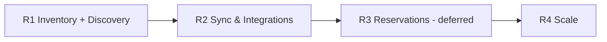

# Functional Requirements Document (FRD)
## Local Commerce & Cloud Inventory Network — Idea_01

| Field | Value |
|---|---|
| Version | 0.1 — draft for review |
| Date | 2026-10-19 |
| Owner | Founder |
| Status | For review by teammates / mentors |
| Source documents | Concept doc `Local_Commerce_Cloud_Inventory_Platform_Detailed_Concept (10).md` (CD), `Backend_System_Design.md` (BSD), `docs/01`–`04` |

### How to review this document
- Every requirement has an **ID** (e.g. `FR-INV-03`). Refer to IDs in comments.
- Every table has a **Review notes** column. Write comments, objections or changes there (name + date), or add rows to the **Review log** in Appendix C.
- Priority uses **MoSCoW**: **M** = Must (release fails without it), **S** = Should, **C** = Could, **W** = Won't in this release.
- **Release**: R1 = first release, R2, R3, R4 = later (see §4).
- **Clients**: **CW** consumer web, **CM** consumer mobile (iOS+Android), **MW** merchant web, **MM** merchant mobile (iOS+Android), **ADM** platform admin.
- Items marked **[TBD]** need a founder/team decision. Items marked **[Verify]** need confirmation from a CA/lawyer.

---

## 1. Introduction

### 1.1 Purpose
This document defines **what** the platform must do: its functions, rules, quality requirements, and the legal and finance constraints. The **how** is in BSD and `docs/01`–`04`. It is the single document for product review. After review, the design docs and implementation follow it.

### 1.2 Product in one paragraph
A multi-tenant cloud platform that lets local shops manage products and inventory across one or more branches (B2B SaaS). It publishes the availability the merchant chooses to share to nearby consumers, who search for products, see trustworthy availability with freshness, and contact or navigate to the shop (B2C discovery). One shared backend serves the consumer web, consumer mobile, merchant web and merchant mobile apps.

### 1.3 Scope summary
| In scope (R1) | Out of scope (R1) |
|---|---|
| Merchant org, branches, staff, roles | Reservations, consumer payments, delivery (deferred → R3, D-19) |
| Catalogue, barcodes, categories, attributes | POS / accounting-software connectors (R2) |
| Inventory ledger, receipts, sales, adjustments, counts, transfers | Purchase orders and supplier workflows beyond basics (R2) |
| CSV/Excel import & export | Sponsored listings, ads (R4) |
| Offline-capable merchant mobile with barcode scan | Pharmacy and other restricted categories (flagged off) |
| Merchant publication controls | Consumer-to-merchant chat |
| Consumer search, nearby shops, availability, freshness, call/directions | AI features |
| Inaccuracy reports | Multi-country |
| Merchant subscription billing (Free / Premium) | |
| English + Hindi | Other regional languages (later) |

### 1.4 Definitions
| Term | Meaning |
|---|---|
| Organisation (org) / tenant | A merchant business account; all its data is isolated from other orgs |
| Branch | A physical shop location of an org |
| Product | Merchant's item (with optional link to a platform canonical product) |
| Ledger / stock movement | Append-only record of every stock change |
| Balance | Current stock per branch × product (on-hand, reserved, unsellable) |
| Sellable | on_hand − reserved − unsellable |
| Public listing | The merchant-approved public view of a product at a branch |
| Freshness | Time since the stock of a listing was last verified |
| Availability label | Public status shown to consumers (see BR-01) |

---

## 2. Business context

### 2.1 Problems
- **Consumer:** can't tell which nearby shop has a specific item in stock. They waste trips and calls.
- **Merchant:** paper or desktop-bound inventory, no remote or multi-branch visibility, poor discoverability.

### 2.2 Goals (R1)
| ID | Goal | Measure (target to be agreed) | Review notes |
|---|---|---|---|
| G-1 | Merchants get value from inventory even without consumer traffic | Weekly active merchants; % of pilot merchants still active after 60 days [TBD target] | |
| G-2 | Inventory stays fresh | % of published listings fresher than their TTL [TBD target] | |
| G-3 | Consumers find relevant nearby stock | % of searches with ≥1 nearby match; search-to-call/directions rate [TBD] | |
| G-4 | Trust | Inaccuracy reports per 1,000 views [TBD] | |
| G-5 | Revenue validation | % of merchants converting to Premium; willingness to pay [TBD] | |

### 2.3 Non-goals (R1)
Taking consumer payments, doing deliveries, replacing accounting/GST billing software, guaranteeing availability.

---

## 3. Users, roles and permissions

### 3.1 User types
| User | Client(s) | Notes |
|---|---|---|
| Consumer (anonymous) | CW, CM | Search and browse without login |
| Consumer (logged in) | CW, CM | Phone OTP. Needed for favourites and reporting inaccuracy |
| Merchant owner | MW, MM | Creates the org; billing; full control |
| Org admin | MW, MM | Everything except owner-only actions |
| Branch manager | MW, MM | Branch inventory, staff, reports for assigned branches |
| Inventory operator | MM (mainly), MW | Receipts, adjustments, counts, transfers |
| Sales operator | MM | Record sales/returns only |
| Auditor (read-only) | MW | Reads records and audit history |
| Platform admin / support | ADM | Moderation, support (time-boxed, logged access) |

### 3.2 Permission matrix (R1)
✓ = allowed, B = only for assigned branches, — = not allowed.

| Permission | Owner | Org admin | Branch mgr | Inv. operator | Sales op. | Auditor | Review notes |
|---|---|---|---|---|---|---|---|
| Billing & plan | ✓ | — | — | — | — | — | |
| Org settings, delete/export org | ✓ | — (export ✓) | — | — | — | — | |
| Manage branches | ✓ | ✓ | — | — | — | — | |
| Invite/remove staff, assign roles | ✓ | ✓ | B (below manager) | — | — | — | |
| API keys / integrations | ✓ | ✓ | — | — | — | — | |
| Catalogue create/edit | ✓ | ✓ | B | B | — | — | |
| Receipts, adjustments, damage | ✓ | ✓ | B | B | — | — | |
| Record sale / customer return | ✓ | ✓ | B | B | B | — | |
| Stock counts (start/finalize) | ✓ | ✓ | B | B (count only) | — | — | |
| Transfers | ✓ | ✓ | B | B | — | — | |
| Imports / undo import | ✓ | ✓ | B | — | — | — | |
| Publication settings | ✓ | ✓ | B | — | — | — | |
| Reports | ✓ | ✓ | B | B (stock only) | — | ✓ | |
| Audit log view | ✓ | ✓ | B | — | — | ✓ | |
| Approve review-queue items | ✓ | ✓ | B | — | — | — | |

---

## 4. Release plan

| Release | Name | Contents | Status | Review notes |
|---|---|---|---|---|
| **R1** | First release: Inventory + Discovery | Sections 6.1–6.14 marked R1; English + Hindi; all 4 clients; subscription billing | Planned | |
| R2 | Sync & integrations | Scheduled imports, API/webhooks for POS, 1–2 connectors, purchasing (PO/GRN), sync-health dashboard, push for alerts | Planned | |
| R3 | Reservations, payments & delivery | FR-RES (§6.15), per `docs/02` | **Deferred** (D-19) | |
| R4 | Scale & advanced | Batch/expiry/serial, advanced dedupe, sponsored listings, enterprise roles/API, more categories, regional languages | Later | |

---

## 5. Plans and entitlements (Free vs Premium)

> **Founder to fill in after review (D-22).** Candidate features are listed. Mark each column ✓ / limit / blank.

| Feature | Free | Premium | Limit / price notes | Review notes |
|---|---|---|---|---|
| Branches | | | e.g. Free = 1 [TBD] | |
| Staff users | | | e.g. Free = 2 [TBD] | |
| Products (SKUs) | | | [TBD] | |
| Inventory ledger, receipts, sales, adjustments | | | | |
| Barcode scan on mobile | | | | |
| Offline mobile | | | | |
| CSV/Excel import & export | | | | |
| Stock counts | | | | |
| Branch transfers | | | | |
| Low-stock alerts | | | | |
| Basic reports | | | | |
| Advanced reports & scheduled exports | | | | |
| Public shop profile & listings | | | | |
| Rich shop profile (photos, hours, featured) | | | No paid ranking (BR-06) | |
| Audit log | | | | |
| API keys / integrations (R2) | | | | |
| Reservations, payments, delivery (R3) | | | Deferred | |
| Priority support / onboarding help | | | | |
| **Price** (monthly / annual, GST extra or inclusive) | | | [TBD] — finance review | |

---

## 6. Functional requirements

### 6.1 Identity & access (FR-IAM)
| ID | Requirement | Pri | Rel | Clients | Acceptance criteria | Review notes |
|---|---|---|---|---|---|---|
| FR-IAM-01 | Merchant sign-up with phone OTP (email optional) | M | R1 | MW, MM | New user verifies OTP and lands on org-creation step; OTP expires in 5 min; max 5 attempts | |
| FR-IAM-02 | Merchant login via OTP or password | M | R1 | MW, MM | Successful login issues a session; wrong password 5× → temporary lock with backoff | |
| FR-IAM-03 | Consumer login with phone OTP, only when needed (favourites, reports) | M | R1 | CW, CM | Search works without login; prompting for login keeps the user's place | |
| FR-IAM-04 | OTP delivery fallback SMS → WhatsApp → voice | S | R1 | All | If SMS isn't delivered in 30s, the user can choose another channel | |
| FR-IAM-05 | Sessions: short access token + rotating refresh; web uses secure cookies | M | R1 | All | Refresh-token reuse revokes the whole session family (I6) | |
| FR-IAM-06 | Device list and "log out other devices" | S | R1 | All | User sees devices with last-active time; revoke works within 15 min | |
| FR-IAM-07 | Shared shop device mode with per-staff 4-digit PIN | S | R1 | MM | Each action records the staff member; PIN locks after 5 failures (I4) | |
| FR-IAM-08 | Step-up verification for sensitive actions (export, role change, API key, billing) | M | R1 | MW, MM | Fresh OTP required if last verification > 5 min ago (I12) | |
| FR-IAM-09 | Re-verification on new device after 90 days of inactivity | M | R1 | MW, MM | Needs second factor (email OTP or owner/admin approval) (D-08) | |
| FR-IAM-10 | Org switcher for users in multiple orgs | S | R1 | MW, MM | Data shown always belongs to the active org only | |
| FR-IAM-11 | Account recovery for owner via second owner/admin or support verification | M | R1 | MW, ADM | Recovery is audited; support flow needs documented identity proof (I7) | |
| FR-IAM-12 | Consumer account deletion | M | R1 | CW, CM | Personal data erased/anonymised as in §10; confirmation shown | |
| FR-IAM-13 | Merchant user deletion / leaving an org | M | R1 | MW | Memberships removed; sessions revoked; ledger keeps the actor reference | |
| FR-IAM-14 | Consumers must confirm they are 18+ at login | M | R1 | CW, CM | Under-18 users can't create an account (avoids parental-consent duty — §12) [Verify] | |

### 6.2 Organisation & branches (FR-ORG)
| ID | Requirement | Pri | Rel | Clients | Acceptance criteria | Review notes |
|---|---|---|---|---|---|---|
| FR-ORG-01 | Create org: legal/trade name, business category, GSTIN (optional), contact | M | R1 | MW, MM | Org created; creator becomes owner; GSTIN format validated if entered | |
| FR-ORG-02 | Add/edit branches: name, address, map pin, phone, hours, timezone | M | R1 | MW, MM | Map pin required before a branch can be published; hours per weekday + holidays | |
| FR-ORG-03 | "Closed today / temporarily closed" toggle | M | R1 | MW, MM | Public profile shows "Closed" within 60s | |
| FR-ORG-04 | Invite staff by phone, assign role and branch scope | M | R1 | MW, MM | Invite expires in 7 days; accepted invite creates membership | |
| FR-ORG-05 | Change role, suspend, remove staff | M | R1 | MW | Takes effect immediately; offline ops of a removed user go to review (D-02) | |
| FR-ORG-06 | Ownership transfer | S | R1 | MW, ADM | Requires current owner + step-up; audited (I9) | |
| FR-ORG-07 | Org data export (all products, stock, movements, users) | M | R1 | MW | CSV/ZIP export downloadable within 15 min; step-up required | |
| FR-ORG-08 | Close org with 30-day cooling-off | M | R1 | MW | Public listings hidden at once; deletion after 30 days (B3) | |
| FR-ORG-09 | Branch-level settings: low-stock thresholds default, freshness defaults | S | R1 | MW | Applied to new products in the branch | |

### 6.3 Catalogue (FR-CAT)
| ID | Requirement | Pri | Rel | Clients | Acceptance criteria | Review notes |
|---|---|---|---|---|---|---|
| FR-CAT-01 | Create/edit product: name (EN + optional HI), brand, model, category, unit, pack size, description, images | M | R1 | MW, MM | Required: name, category, unit | |
| FR-CAT-02 | Identifiers: barcode(s), SKU, aliases; unique **within org** | M | R1 | MW, MM | Duplicate barcode in the same org → error with link to the existing product (C1) | |
| FR-CAT-03 | Add product by scanning barcode; prefill from platform catalogue if known | S | R1 | MM | Scan → existing product opens, or new-product form prefilled | |
| FR-CAT-04 | Category-specific attributes from a schema (size, colour, capacity…) | M | R1 | MW, MM | Invalid attributes rejected with field messages (C5) | |
| FR-CAT-05 | Variants (size/colour) under a parent product | S | R1 | MW | Each variant has its own stock; parent groups them in search (C4) | |
| FR-CAT-06 | Units and conversions (e.g. 1 box = 12 pcs) | M | R1 | MW, MM | Movement in an unconvertible unit is rejected (S4) | |
| FR-CAT-07 | Product without barcode gets a platform short code | S | R1 | MW, MM | Short code is searchable; printable label in R2 | |
| FR-CAT-08 | Activate/deactivate product | M | R1 | MW, MM | Inactive products can't be sold or published | |
| FR-CAT-09 | Duplicate detection and merge | S | R1 | MW | Merge keeps history; old ID becomes an alias (C3) | |
| FR-CAT-10 | Link to platform canonical product (suggested, merchant confirms) | C | R1 | MW | Never automatic; improves consumer search grouping | |
| FR-CAT-11 | Restricted categories flagged and not publishable | M | R1 | MW, ADM | Pharmacy etc. can be used for inventory but not published (C6, D-04) | |
| FR-CAT-12 | Product images upload with compression | S | R1 | MW, MM | Max 5 images; ≤ 5 MB each before compression; JPG/PNG/WebP only | |

### 6.4 Inventory operations (FR-INV)
| ID | Requirement | Pri | Rel | Clients | Acceptance criteria | Review notes |
|---|---|---|---|---|---|---|
| FR-INV-01 | Opening stock per branch × product | M | R1 | MW, MM | Creates an `opening` movement; editable only via adjustments afterwards | |
| FR-INV-02 | Stock receipt (from supplier, optional supplier name, cost, invoice ref) | M | R1 | MW, MM | Balance increases; receipt visible in history | |
| FR-INV-03 | Record sale (quick "sell by scan", quantity default 1) | M | R1 | MM, MW | 2 taps after scan; works offline; balance decreases | |
| FR-INV-04 | Customer return, supplier return | M | R1 | MW, MM | Return into sellable or unsellable as chosen | |
| FR-INV-05 | Adjustment with reason (damage, expiry, loss, found, correction) | M | R1 | MW, MM | Reason mandatory; org can add custom reason labels | |
| FR-INV-06 | One-tap "mark out of stock / in stock" for low-effort shops | M | R1 | MM | Sets public status without exact quantity when the merchant uses "status-only" tracking for that product | |
| FR-INV-07 | Negative stock allowed with discrepancy flag | M | R1 | All merchant | Sale never blocked; discrepancy task created; public label "Check with shop" (D-01, S3) | |
| FR-INV-08 | Reverse a movement (once) | M | R1 | MW | Creates compensating movement; second reverse rejected (S8) | |
| FR-INV-09 | Large-quantity confirmation | S | R1 | MW, MM | > 10× typical quantity asks for confirmation (S10) | |
| FR-INV-10 | Backdating limit (default 30 days; older needs admin + reason) | M | R1 | MW, MM | Future dates beyond 5 min rejected (S5, S6) | |
| FR-INV-11 | Stock history per product (ledger view with who/when/why/source) | M | R1 | MW, MM | Filter by date, type, user, branch | |
| FR-INV-12 | Stock count (cycle or full) without freezing sales | M | R1 | MM, MW | Correction = counted − stock at counted time (D-06, T4) | |
| FR-INV-13 | Branch transfer (draft → dispatched → received) with in-transit stock | S | R1 | MW, MM | Shortage on receipt posted with reason (T1–T3) | |
| FR-INV-14 | Low-stock threshold per product/branch and alerts | M | R1 | MW, MM | Alert in app (and push in R2) when sellable ≤ threshold | |
| FR-INV-15 | Unsellable stock bucket (damaged/expired/quarantined) | S | R1 | MW, MM | Excluded from sellable and public availability | |
| FR-INV-16 | Batch / lot / expiry / serial tracking | C | R4 | MW, MM | Optional per category | |
| FR-INV-17 | Idempotent submissions (no double counting on retry) | M | R1 | All merchant | Same request twice = one movement (S1) | |

### 6.5 Offline merchant mobile (FR-OFF)
| ID | Requirement | Pri | Rel | Clients | Acceptance criteria | Review notes |
|---|---|---|---|---|---|---|
| FR-OFF-01 | Sales, receipts, adjustments, counts work offline | M | R1 | MM | Queued with a local ID; synced automatically when online | |
| FR-OFF-02 | Product lookup and barcode scan offline (cached catalogue) | M | R1 | MM | Catalogue of assigned branches cached; refresh on sync | |
| FR-OFF-03 | Sync status banner ("Last synced X ago", pending count) | M | R1 | MM | Visible on home screen | |
| FR-OFF-04 | Per-operation sync results; failures shown with fix actions | M | R1 | MM | Rejected ops listed; user can edit/retry/discard with reason (O6) | |
| FR-OFF-05 | Block logout while ops are pending (with warning override) | M | R1 | MM | (O8) | |
| FR-OFF-06 | Branch shows "Check with shop" publicly after 24h without sync | M | R1 | System | (O1) | |
| FR-OFF-07 | Delta pull of changes from other devices | M | R1 | MM | Balances update after sync without full reload | |
| FR-OFF-08 | Old app version handling | M | R1 | MM, CM | Force-upgrade screen when below minimum; queue preserved (O10) | |

### 6.6 Imports & exports (FR-IMP)
| ID | Requirement | Pri | Rel | Clients | Acceptance criteria | Review notes |
|---|---|---|---|---|---|---|
| FR-IMP-01 | Downloadable templates (products, opening stock, stock snapshot) in EN/HI headers | M | R1 | MW | Template matches validation rules | |
| FR-IMP-02 | Upload CSV/XLSX up to 20 MB / 100k rows | M | R1 | MW | Larger files rejected with a message (M8) | |
| FR-IMP-03 | Preview with validation errors before apply | M | R1 | MW | First 50 rows + error summary; nothing changes before "Apply" (M3, M4) | |
| FR-IMP-04 | Map unknown products / columns; remember mappings | M | R1 | MW | Review queue for unknowns (M5) | |
| FR-IMP-05 | Snapshot import computes difference using the snapshot's timestamp | M | R1 | MW | Later sales not overwritten (M1, M2) | |
| FR-IMP-06 | Import job report (applied/skipped/errors, downloadable) | M | R1 | MW | Available for 90 days | |
| FR-IMP-07 | Undo import | M | R1 | MW | Compensating movements; blocked if a count was finalized since then (M7) | |
| FR-IMP-08 | Exports: products, current stock, movements (date range) | M | R1 | MW | CSV/XLSX | |
| FR-IMP-09 | Scheduled imports (SFTP/email/URL) | S | R2 | MW | — | |
| FR-IMP-10 | API keys + stock-event API for POS / scripts | S | R2 | MW | HMAC-signed; idempotent by event ID (M10, M11) | |
| FR-IMP-11 | Local connector for desktop software | C | R2 | — | Per vendor, after discovery | |

### 6.7 Publication controls (FR-PUB)
| ID | Requirement | Pri | Rel | Clients | Acceptance criteria | Review notes |
|---|---|---|---|---|---|---|
| FR-PUB-01 | Publish/unpublish per branch | M | R1 | MW, MM | Unpublished branch disappears from search within 60s (Q3) | |
| FR-PUB-02 | Publish/unpublish per product (bulk by category) | M | R1 | MW | Default for new products = org setting | |
| FR-PUB-03 | Show price: yes/no per product; price hidden if older than 14 days | M | R1 | MW | (D-10, Q9) | |
| FR-PUB-04 | Exposure level is status only (never exact quantity) | M | R1 | System | Public API never returns quantity (D-05) | |
| FR-PUB-05 | Imported data: publish immediately or after review | S | R1 | MW | Org setting | |
| FR-PUB-06 | Public contact options per branch (call, WhatsApp link, none) | M | R1 | MW | Only selected options are shown | |
| FR-PUB-07 | Publication readiness checklist (pin, hours, photo, ≥N products) | S | R1 | MW, MM | Shown during onboarding | |
| FR-PUB-08 | Merchant consent to publish recorded (who/when/what) | M | R1 | System | Audit event per change (§12 legal) | |

### 6.8 Consumer search & discovery (FR-SRCH)
| ID | Requirement | Pri | Rel | Clients | Acceptance criteria | Review notes |
|---|---|---|---|---|---|---|
| FR-SRCH-01 | Search by product name, brand, model, barcode, alias | M | R1 | CW, CM | Results in < 1 s p95 end-to-end on 4G [Verify target] | |
| FR-SRCH-02 | Typo tolerance, Hindi (Devanagari) and Hinglish/transliteration | M | R1 | CW, CM | "pankha", "पंखा" and "fan" find the same products (Q8) | |
| FR-SRCH-03 | Location: GPS (with permission) or pincode/area picker | M | R1 | CW, CM | Works fully without GPS (Q1) | |
| FR-SRCH-04 | Radius filter and automatic widening when no results | M | R1 | CW, CM | 2 → 5 → 10 km (Q2) | |
| FR-SRCH-05 | Result card: shop, distance, availability label, freshness ("updated 2 h ago"), price if published | M | R1 | CW, CM | Label rules per BR-01, BR-02 | |
| FR-SRCH-06 | Filters: availability, distance, category, brand, open now, price shown | S | R1 | CW, CM | "Open now" only when hours verified (Q7) | |
| FR-SRCH-07 | Browse by shop category and product category | M | R1 | CW, CM | | |
| FR-SRCH-08 | Ranking: relevance × distance × availability confidence × freshness; no paid ranking | M | R1 | System | (BR-06) | |
| FR-SRCH-09 | Map view of results | S | R1 | CW, CM | | |
| FR-SRCH-10 | Barcode scan to search | C | R1 | CM | | |
| FR-SRCH-11 | Recent searches (on device) and favourites (logged in) | C | R1 | CW, CM | | |
| FR-SRCH-12 | SEO-friendly public shop and product pages | S | R1 | CW | Server-rendered; correct titles/meta; no private data | |
| FR-SRCH-13 | Zero-result queries logged (anonymous) for demand insights | S | R1 | System | No personal data stored with query | |

### 6.9 Shop profile & contact (FR-SHOP)
| ID | Requirement | Pri | Rel | Clients | Acceptance criteria | Review notes |
|---|---|---|---|---|---|---|
| FR-SHOP-01 | Public branch page: name, address, map, hours (verified flag), contact, categories, listed products | M | R1 | CW, CM | | |
| FR-SHOP-02 | Call, WhatsApp, directions (opens maps app) | M | R1 | CW, CM | Taps are counted as anonymous events for merchant reports | |
| FR-SHOP-03 | Share shop/product link | S | R1 | CW, CM | | |
| FR-SHOP-04 | Legal info display (merchant legal name, address, grievance contact of the platform) | M | R1 | CW, CM | Per §12 e-commerce/IT rules review [Verify] | |

### 6.10 Inaccuracy reports & trust (FR-RPT)
| ID | Requirement | Pri | Rel | Clients | Acceptance criteria | Review notes |
|---|---|---|---|---|---|---|
| FR-RPT-01 | Consumer reports "not available / wrong price / shop closed / wrong info" (login required) | M | R1 | CW, CM | Report reaches the merchant inbox | |
| FR-RPT-02 | Merchant sees, fixes or disputes reports | M | R1 | MW, MM | Status: open / fixed / disputed | |
| FR-RPT-03 | Report weighting and abuse limits | S | R1 | System | Max reports per user/day; no auto-delisting (Q6) | |
| FR-RPT-04 | Content/listing takedown process (platform admin) | M | R1 | ADM | Complaint → review → action, within IT Rules timelines [Verify] | |
| FR-RPT-05 | Merchant quality signals (freshness %, report rate) | C | R1 | System, MW | Used in ranking (BR-06) | |

### 6.11 Notifications (FR-NOT)
| ID | Requirement | Pri | Rel | Clients | Acceptance criteria | Review notes |
|---|---|---|---|---|---|---|
| FR-NOT-01 | In-app notification centre (merchant): low stock, discrepancies, import results, reports, billing | M | R1 | MW, MM | | |
| FR-NOT-02 | Push notifications | S | R1 | MM, CM | Opt-in; per-type preferences | |
| FR-NOT-03 | SMS/WhatsApp for OTP and critical billing notices only | M | R1 | All | No marketing messages without consent | |
| FR-NOT-04 | Email for reports and billing invoices | S | R1 | MW | | |
| FR-NOT-05 | Daily digest (low stock, stale listings) | C | R1 | MW, MM | | |

### 6.12 Reports & dashboards (FR-REP)
| ID | Requirement | Pri | Rel | Clients | Acceptance criteria | Review notes |
|---|---|---|---|---|---|---|
| FR-REP-01 | Current stock by branch (with value at cost if entered) | M | R1 | MW, MM | Export CSV | |
| FR-REP-02 | Low-stock and out-of-stock lists | M | R1 | MW, MM | | |
| FR-REP-03 | Movement history report | M | R1 | MW | | |
| FR-REP-04 | Discrepancies (negative stock, count variances) | M | R1 | MW | | |
| FR-REP-05 | Fast/slow-moving products | S | R1 | MW | Based on sales movements | |
| FR-REP-06 | Listing freshness report (% fresh, stale list) | M | R1 | MW, MM | | |
| FR-REP-07 | Consumer interest: views, calls, directions per product/branch | S | R1 | MW | Anonymous aggregates only | |
| FR-REP-08 | User activity / audit report | S | R1 | MW | | |
| FR-REP-09 | Sync health dashboard | S | R2 | MW | | |

### 6.13 Billing & subscription (FR-BIL)
| ID | Requirement | Pri | Rel | Clients | Acceptance criteria | Review notes |
|---|---|---|---|---|---|---|
| FR-BIL-01 | Plans (Free/Premium per §5), trial period [TBD] | M | R1 | MW | Entitlements enforced server-side (`ENTITLEMENT_REQUIRED`) | |
| FR-BIL-02 | Pay subscription online (UPI/card/netbanking) via payment gateway; monthly/annual | M | R1 | MW | Payment confirmed by webhook only (P1–P3 patterns) | |
| FR-BIL-03 | GST-compliant tax invoice for each subscription payment, with org GSTIN if given | M | R1 | MW | Invoice fields per GST rules [Verify with CA] | |
| FR-BIL-04 | Failed-payment retries, grace period, then read-only | M | R1 | MW | Data never deleted; export always available (B1) | |
| FR-BIL-05 | Upgrade/downgrade; proration [TBD] | S | R1 | MW | | |
| FR-BIL-06 | Cancel subscription | M | R1 | MW | Clear, no dark patterns (§12) | |
| FR-BIL-07 | Billing history and invoice download | M | R1 | MW | | |
| FR-BIL-08 | Coupons / pilot discounts | C | R1 | MW, ADM | | |

### 6.14 Platform admin & support (FR-ADM)
| ID | Requirement | Pri | Rel | Clients | Acceptance criteria | Review notes |
|---|---|---|---|---|---|---|
| FR-ADM-01 | Admin login with SSO/MFA, IP-restricted | M | R1 | ADM | | |
| FR-ADM-02 | Merchant search, status, plan, suspension | M | R1 | ADM | Suspension hides listings; reason recorded | |
| FR-ADM-03 | Support access to a merchant account: time-boxed, merchant-visible, logged | M | R1 | ADM | Merchant can see support sessions in the audit log | |
| FR-ADM-04 | Moderation queue: reports, takedowns, restricted categories | M | R1 | ADM | | |
| FR-ADM-05 | Category & attribute schema management, synonyms/transliteration dictionary | M | R1 | ADM | | |
| FR-ADM-06 | Feature flags and kill switches (`public_degraded`, categories) | M | R1 | ADM | RB-1 | |
| FR-ADM-07 | Grievance officer inbox with SLA timers | M | R1 | ADM | Timelines per §12 [Verify] | |
| FR-ADM-08 | Platform metrics dashboard (G-1…G-5) | S | R1 | ADM | | |

### 6.15 Reservations, payments & delivery (FR-RES) — **DEFERRED (R3)**
Full design: `docs/02_Reservations_Payments_Delivery.md`. Summary requirements, kept so reviewers can see the future scope:

| ID | Requirement | Pri | Rel | Clients | Acceptance criteria | Review notes |
|---|---|---|---|---|---|---|
| FR-RES-01 | Merchant opt-in per branch/product; Premium only | M | R3 | MW | Preconditions: KYC, price published, hours set | |
| FR-RES-02 | Modes: token + pickup, full + pickup, full + delivery | M | R3 | All | Token set by merchant within platform caps | |
| FR-RES-03 | Atomic stock hold on create; no double allocation | M | R3 | System | R1 in docs/02 | |
| FR-RES-04 | Payment via licensed aggregator; funds held until fulfilment | M | R3 | System | No funds in platform account (D-09) | |
| FR-RES-05 | Merchant accept/decline within deadline; auto-refund otherwise | M | R3 | MW, MM | R2 in docs/02 | |
| FR-RES-06 | Pickup code / delivery OTP for handover; releases funds | M | R3 | All | D-15 | |
| FR-RES-07 | Preset cancellation policies; policy preview before cancel | M | R3 | All | D-13 | |
| FR-RES-08 | No-show: token forfeited; repeat no-show limit | M | R3 | System | D-14 | |
| FR-RES-09 | Merchant-owned delivery within radius; failed-delivery handling | S | R3 | MM, CM | D1–D6 | |
| FR-RES-10 | Refunds, disputes, settlement reconciliation | M | R3 | System, ADM | P10–P15 | |

### 6.16 Localisation & accessibility (FR-L10N)
| ID | Requirement | Pri | Rel | Clients | Acceptance criteria | Review notes |
|---|---|---|---|---|---|---|
| FR-L10N-01 | UI in English and Hindi; switchable anytime | M | R1 | All | All user-facing strings externalised; no hard-coded text (D-20) | |
| FR-L10N-02 | Product names in EN and optional HI | S | R1 | MW, MM | Search indexes both | |
| FR-L10N-03 | Indian formats: ₹, lakh/crore grouping option, DD-MM-YYYY, IST | M | R1 | All | | |
| FR-L10N-04 | Add a new language without code changes (translation files) | S | R1 | All | | |
| FR-L10N-05 | Accessibility: WCAG 2.1 AA for web; screen-reader labels and 48dp touch targets on mobile | S | R1 | All | Audit before launch | |
| FR-L10N-06 | Low-bandwidth mode: compressed images, list without map | S | R1 | CW, CM | Usable on 3G | |

### 6.17 Audit (FR-AUD)
| ID | Requirement | Pri | Rel | Clients | Acceptance criteria | Review notes |
|---|---|---|---|---|---|---|
| FR-AUD-01 | Audit events for: login/security, role changes, exports, publication changes, imports/undo, reversals, support access, billing | M | R1 | System | Who, what, when, from which device/IP; tamper-evident (append-only) | |
| FR-AUD-02 | Audit log view and export for owner/admin/auditor | M | R1 | MW | Filter by user, type, date | |
| FR-AUD-03 | No secrets or unnecessary personal data in audit/log records | M | R1 | System | Reviewed in security checks | |

---

## 7. Key user journeys

### UJ-1 Merchant onboarding (target < 20 min to first published product)
1. Sign up with phone OTP (FR-IAM-01) → create org (FR-ORG-01) → add branch with map pin and hours (FR-ORG-02).
2. Add products: scan barcodes, import a template, or type them in (FR-CAT-03, FR-IMP-01..05).
3. Enter opening stock (FR-INV-01).
4. Review the publication checklist → publish (FR-PUB-07, FR-PUB-01).
5. Invite staff (FR-ORG-04).
**Edge cases:** import errors (M3–M5), missing pin (blocks publishing), weak network (offline queue).

### UJ-2 Daily shop use (mobile)
Scan → sell (2 taps) → offline OK → auto-sync → low-stock alert → receive stock with scan.
**Edge cases:** O1–O10, S3 (negative stock), S10 (large quantities).

### UJ-3 Consumer finds a product
Open app/web → search "LED bulb 9W" (Hindi or English) → choose location → see nearby shops with label and freshness → call or get directions → optionally report inaccuracy.
**Edge cases:** no results (Q2), location denied (Q1), stale data (BR-02), shop closed (FR-ORG-03).

### UJ-4 Stock count
Start count → scan and count lines (with timestamps) → finalize → corrections posted → discrepancy report.
**Edge cases:** T4–T6.

### UJ-5 Subscription
Free → hit a limit → upgrade → pay → invoice → renewal → failed payment → grace → read-only.
**Edge cases:** B1–B4, P1–P3 patterns.

---

## 8. Business rules

| ID | Rule | Review notes |
|---|---|---|
| BR-01 | **Availability labels:** *Available* (sellable > low-stock threshold and fresh); *Limited stock* (0 < sellable ≤ threshold and fresh); *Out of stock* (sellable ≤ 0 and fresh); *Check with shop* (stale, discrepancy, branch unsynced > 24h, or status-only product not updated within TTL); *Temporarily unavailable* (merchant marked it) | |
| BR-02 | **Freshness TTL** by source: native app 24h, CSV 72h, manual status 7 days; configurable per category (D-16) | |
| BR-03 | Sellable = on_hand − reserved − unsellable (reserved is 0 until R3) | |
| BR-04 | Negative stock allowed; always flagged (D-01) | |
| BR-05 | Exact quantity never public (D-05) | |
| BR-06 | Ranking never purely paid; sponsored results (R4) must be labelled | |
| BR-07 | Price shown only if merchant enabled it and updated within 14 days (D-10); labelled "Price set by shop, may change" | |
| BR-08 | Restricted categories can't be published (D-04) | |
| BR-09 | History is never edited; corrections are new movements | |
| BR-10 | All times stored in UTC, displayed in IST (branch timezone) | |
| BR-11 | Money stored as integer paise; quantities as decimals with 3 places; no floating point | |
| BR-12 | Subscription lapse → read-only after grace; data never deleted for non-payment | |

---

## 9. Non-functional requirements

| ID | Category | Requirement | Review notes |
|---|---|---|---|
| NFR-01 | Availability | 99.5% monthly in pilot (D-07) | |
| NFR-02 | Performance | Search API p95 < 400 ms; merchant mutation p95 < 300 ms; listing update visible publicly p95 < 30 s | |
| NFR-03 | Mobile performance | App cold start < 3 s on a mid-range Android; works on 3G | |
| NFR-04 | Platform support | Android 8+ [Verify], iOS 15+ [Verify]; last 2 versions of Chrome, Safari, Edge, Firefox; responsive down to 360px width | |
| NFR-05 | Scalability | Pilot: 500 merchants / 50k SKUs per merchant without redesign (BSD B13) | |
| NFR-06 | Backup & recovery | RPO ≤ 5 min, RTO ≤ 1 h; monthly restore drill | |
| NFR-07 | Security | Tenant isolation in app and DB (RLS); TLS; encryption at rest; secrets manager; OWASP ASVS L2 as target; annual pen-test before scale | |
| NFR-08 | Privacy | DPDP-ready by design (§12); data stored in India (AWS Mumbai) | |
| NFR-09 | Logging | Logs kept ≥ 1 year (covers DPDP 1-year and CERT-In 180-day requirements [Verify]); clocks NTP-synced; no PII in logs | |
| NFR-10 | Observability | Metrics, traces, error tracking, alerts per `docs/04` | |
| NFR-11 | Maintainability | Modular monolith; OpenAPI contract; automated tests incl. cross-tenant suite | |
| NFR-12 | Compatibility | API supports current + previous 2 app versions; force-upgrade mechanism | |
| NFR-13 | Accessibility | FR-L10N-05 | |
| NFR-14 | Usability | Core merchant actions ≤ 3 taps; Hindi UI tested with pilot merchants | |

---

## 10. Data requirements & retention

| Data | Purpose | Retention (proposed) | Legal basis / note | Review notes |
|---|---|---|---|---|
| Consumer phone number | Login, reports | Until deletion + required log period | Consent; DPDP notice [Verify] | |
| Consumer location | Nearby search | Not stored server-side beyond request; on-device recent area only | Consent at OS level | |
| Search queries | Service + demand insights | Aggregated/anonymised; raw ≤ 90 days | Legitimate service use [Verify] | |
| Merchant user profiles | Account | Account life + 1 year after closure | Contract | |
| Inventory, ledger, catalogue | Core service (merchant's business data) | Account life; export on exit; deleted 30 days after closure (except legal records) | Contract (merchant's data) | |
| Audit events, security logs | Security, compliance | ≥ 1 year (DPDP Rules) [Verify] | Legal obligation | |
| Subscription invoices & payments | Tax records | Statutory period [Verify with CA — typically several years] | Legal obligation | |
| Inaccuracy reports | Trust | 2 years | [Verify] | |

---

## 11. External integrations (R1)

| Service | Use | Fallback | Review notes |
|---|---|---|---|
| SMS/OTP provider ×2 | OTP | WhatsApp, voice | |
| WhatsApp Business API | OTP fallback, critical notices | SMS | |
| Push (FCM; APNs via FCM) | Notifications | In-app centre | |
| Maps / geocoding | Map pins, directions links, pincode lookup | Pincode table | |
| Payment gateway (e.g. Razorpay) | Subscription billing only | Retry later | |
| Email provider | Invoices, reports | — | |
| Cloud (AWS Mumbai) | Hosting, DB, storage | — | |

---

## 12. Legal & finance compliance (pre-launch)

Prepared with the `india-legal-helper-senior-advisor` and `india-senior-ca-finance-controller` skills. **Research date: 2026-10-19.** This is research for review, **not legal or tax advice**. Every item marked [Verify] needs confirmation from a practising lawyer or CA before launch. Primary sources are listed in §12.6. Several findings rely on secondary commentary and are marked as such.

### 12.1 Facts and assumptions used
- Entity **not yet incorporated**. Founders are Indian residents (assumed). No foreign investment yet (assumed).
- R1 business: B2B SaaS subscriptions to merchants, plus a free public discovery platform showing merchant listings (with optional prices). **No consumer payments, no sale of goods by or through the platform** in R1.
- Personal data: consumer phone numbers (optional login), approximate location per request, merchant staff data, and merchants' business data.
- Pilot state: **undecided** (state-specific items are placeholders).

### 12.2 Applicability matrix
| # | Law / rule | Applies in R1? | Why / what it means for the product | Confidence | Review notes |
|---|---|---|---|---|---|
| L-1 | **Companies Act, 2013** — entity choice | Decision | **Recommend Private Limited**: needed for equity fundraising and ESOPs; DPIIT-eligible. If the E-Commerce Rules apply (L-5), secondary sources state the e-commerce entity should be a company. LLP is cheaper but poor for VC funding | Moderate | |
| L-2 | **DPDP Act, 2023 + DPDP Rules, 2025** | Yes (phased) | Rules notified Nov 2025 (sources differ: 13 or 14 Nov — check G.S.R. 843(E)). Board provisions immediate; Consent Manager registration at 12 months (Nov 2026); **notice, consent, security, breach reporting, children's consent and data-principal rights at 18 months (≈ 13/14 May 2027)**. Build to comply from R1: clear notice + consent, consent withdrawal, access/correction/erasure requests, breach-response process, ≥1-year retention of processing logs, grievance response ≤ 90 days. **Block under-18 consumer accounts** to avoid the verifiable parental consent duty (FR-IAM-14). Breach-notice timeline (72h widely cited) → [Verify against Rule text] | Moderate (dates from law-firm summaries; official PDF not machine-readable) | |
| L-3 | **IT Act, 2000 s.79 + IT (Intermediary Guidelines) Rules, 2021** | Likely yes | The platform hosts third-party (merchant) listings, so it is likely an intermediary. Due diligence: publish rules/privacy policy/user agreement, appoint a **Grievance Officer** (acknowledge in 24h, resolve in 15 days; 72h for certain content-removal complaints per the 2022 amendment), Grievance Appellate Committee awareness. Post-2022 amendments not checked → [Verify] | Moderate | |
| L-4 | **CERT-In Directions (28 Apr 2022, s.70B IT Act)** | Yes | Report specified cyber incidents within **6 hours** of noticing them; keep ICT logs **180 days** within Indian jurisdiction; NTP time sync. Effective date cited differently (27 Jun 2022 / extension to 25 Sep 2022) — compliance is current in either case | Moderate–High | |
| L-5 | **Consumer Protection Act, 2019 + Consumer Protection (E-Commerce) Rules, 2020** | **Unclear** | Rules cover entities that own or operate a platform for "electronic commerce" (buying/selling goods or services online). R1 has no transaction, so a pure discovery platform *may* fall outside. **Conservative approach:** comply with the Rule 4-type basics anyway — India-resident nodal officer, display legal name/address/contact/grievance officer, grievance redressal (acknowledge 48h, resolve 1 month). **Definitely applies from R3** (reservations/payments) → [Counsel opinion needed] | Low–Moderate | |
| L-6 | **Legal Metrology (Packaged Commodities) Rules, 2011 — Rule 6(10)** | Unclear / low in R1 | E-commerce entities must display mandatory declarations (manufacturer/packer/importer, country of origin, net quantity, MRP, dates, consumer care) for pre-packaged goods. R1 doesn't sell, but shows prices. Mitigation: show "Price set by shop", never claim MRP; allow merchants to add declarations; review before R3. A draft amendment proposing country-of-origin filters was seen — status not confirmed → [Verify] | Low | |
| L-7 | **CCPA Dark Patterns Guidelines, 2023** | Yes (UX) | Applies to platforms offering goods/services in India. Avoid false urgency, forced subscription, hidden renewal, confirm-shaming, drip pricing in signup/billing (FR-BIL-06) → [Verify current status] | Moderate | |
| L-8 | **RBI payment aggregator rules / PSS Act, 2007** | Not for R1 | In R1 the platform only collects **its own** subscription fees through a licensed gateway as a normal merchant → no PA licence needed. **R3 changes this** (collecting for merchants → must use a licensed PA with escrow/marketplace settlement) | Moderate–High | |
| L-9 | Category laws (Drugs & Cosmetics Act 1940, FSSAI, etc.) | Avoided | Restricted categories are not publishable in R1 (FR-CAT-11) | High | |
| L-10 | **Shops & Establishments Act (state)** | Yes, for the startup's own office | Register the office under the pilot state's Act → [Depends on state] | High (that it applies) | |
| L-11 | Labour law / POSH Act, 2013 | Yes as the team grows | Internal Committee once there are 10+ employees; contractor vs employee classification; status of the labour codes → [Verify] | Moderate | |
| L-12 | **Trade Marks Act, 1999** | Recommended | Search and file the brand name/logo in relevant classes (software/SaaS and online platform services) before launch; secure domain and app-store names | High | |
| L-13 | Copyright / IP assignment | Yes | Founders', employees' and freelancers' IP assigned to the company; open-source licence compliance for app code | High | |
| L-14 | App-store policies (Apple/Google) | Yes | In-app account deletion, privacy labels/data safety form, location permission rationale | High | |

### 12.3 Finance & tax matrix
| # | Topic | R1 position | Confidence | Review notes |
|---|---|---|---|---|
| F-1 | **GST registration** | Register at incorporation (voluntary below the threshold is allowed): B2B merchants want input-tax credit invoices, and gateways/app stores often ask for a GSTIN. The services threshold (commonly ₹20 lakh, ₹10 lakh in special-category states) → [Verify] | Moderate | |
| F-2 | **GST on SaaS subscription** | 18% per multiple secondary sources, unchanged after the Sept 2025 rate rationalisation. SAC code is disputed between sources (998314 vs 998315) → **CA to fix the SAC** for invoices | Moderate (secondary sources) | |
| F-3 | **Invoices** | GST tax invoice per payment (FR-BIL-03); e-invoicing only above the turnover threshold → [Verify]; place of supply = merchant's state (B2B) | Moderate | |
| F-4 | **E-commerce operator TCS (s.52 CGST) / TDS (s.194-O)** | **Not applicable in R1**: no supplies by merchants routed through the platform with the platform collecting consideration. Applies when R3 launches → re-research then | Moderate | |
| F-5 | **DPIIT recognition** | Apply after incorporation. Per G.S.R. 108(E) dated 4 Feb 2026 (secondary sources): recognised for up to **10 years** from incorporation, with turnover ≤ **₹200 crore** in any year. Recognition ≠ tax holiday | Moderate | |
| F-6 | **Tax holiday (80-IAC / equivalent under the Income-tax Act, 2025)** | Needs a separate Inter-Ministerial Board certificate; turnover limit ₹100 crore (secondary sources). Only useful once profitable | Moderate | |
| F-7 | **Angel tax** | Reported as abolished from 1 Apr 2025 (secondary sources) → less fundraising friction; confirm with CA at the first raise | Moderate | |
| F-8 | **TDS on our payments** | Deduct TDS on payments to freelancers, agencies, contractors and rent per thresholds → [Verify rates/thresholds at payment date] | High (that it applies) | |
| F-9 | **Imported services** (AWS, Google, Apple, SMS/maps APIs) | GST reverse charge / OIDAR treatment and remittance documentation → [CA review] | Moderate | |
| F-10 | **Revenue recognition** | Annual plans recognised monthly (deferred revenue); gateway fees booked separately; monthly gateway-to-bank reconciliation | High | |
| F-11 | **Books & calendar** | Accounting software from day 1; monthly GST/TDS, quarterly TDS returns, annual ROC + ITR + audit → [Verify due dates] | High | |
| F-12 | **Pricing display** | Show merchant plan prices "+ GST" or GST-inclusive consistently; decide with CA (§5) | High | |

### 12.4 Risk register
| ID | Risk | Authority | Severity | Likelihood | Impact | Mitigation | Owner / urgency | Review notes |
|---|---|---|---|---|---|---|---|---|
| RK-1 | Launching personal-data features without a DPDP-ready notice/consent design | L-2 | High | Possible | Penalties after May 2027; rework | Build notice/consent/rights flows in R1 (FR-IAM-12, §10) | Founder · Before launch | |
| RK-2 | Platform treated as an e-commerce entity without compliance | L-5 | Medium | Possible | Consumer complaints, CCPA action | Rule 4-style basics now; counsel opinion | Founder + counsel · Before launch | |
| RK-3 | Wrong availability or price leads to consumer complaints | L-5, L-7 | Medium | Likely | Trust, complaints | Freshness labels, price disclaimers, reports, BR-01/07 | Product · R1 | |
| RK-4 | Missing grievance officer / takedown process | L-3 | Medium | Possible | Losing safe-harbour protection | FR-ADM-07, FR-RPT-04 | Founder · Before launch | |
| RK-5 | Cyber incident not reported in 6h | L-4 | High | Unlikely | Penalty, reputation | Incident runbook RB-7, on-call | Tech · Before launch | |
| RK-6 | Founders' IP not assigned / brand not protected | L-12, L-13 | High | Possible | Investor diligence failure, brand loss | IP assignment at incorporation; TM filing | Founder · At incorporation | |
| RK-7 | Wrong GST SAC/rate on invoices | F-2 | Medium | Possible | Notices, interest | CA fixes the SAC before the first invoice | Founder + CA · Before billing | |
| RK-8 | Restricted category listed by a merchant | L-9 | High | Possible | Regulatory | FR-CAT-11, moderation | Ops · R1 | |
| RK-9 | Minors creating accounts | L-2 | Medium | Possible | Children's-data duties | 18+ confirmation (FR-IAM-14), no child-targeted content | Product · R1 | |
| RK-10 | Starting R3 payments without PA/escrow structure | L-8, F-4 | Critical | — (deferred) | Regulatory | Re-research before R3 | Founder · Before R3 | |

### 12.5 Pre-launch checklist
| # | Item | Owner | Due | Status | Review notes |
|---|---|---|---|---|---|
| C-1 | Incorporate Private Limited (SPICe+), PAN/TAN, bank account | Founder + CA/CS | | Not started | |
| C-2 | Founders' agreement (equity, vesting, IP assignment, roles) | Founder + lawyer | | Not started | |
| C-3 | Trademark search & filing; domain; app-store accounts in company name | Founder | | Not started | |
| C-4 | GST registration; fix SAC & invoice format | CA | | Not started | |
| C-5 | DPIIT recognition application | Founder + CA | | Not started | |
| C-6 | Shops & Establishments registration (pilot state) | Founder | | Depends on state | |
| C-7 | Drafts: Consumer Terms, Merchant SaaS Terms, Privacy Notice, Grievance Policy, Content/Listing Policy, Cookie notice | Lawyer (drafts can be prepared with the legal skill) | | Not started | |
| C-8 | Appoint Grievance Officer (and nodal officer if L-5 applies); publish contacts | Founder | | Not started | |
| C-9 | DPDP: data map, consent text (EN + HI), rights-request process, breach-response plan | Founder + tech | | Not started | |
| C-10 | CERT-In incident process; 1-year log retention in India | Tech | | Not started | |
| C-11 | Accounting software, chart of accounts, compliance calendar | CA | | Not started | |
| C-12 | Payment gateway merchant account (subscription billing) | Founder | | Not started | |
| C-13 | Counsel opinion on L-5 (E-Commerce Rules) and L-6 (Legal Metrology) applicability | Lawyer | | Not started | |

### 12.6 Sources (accessed 2026-10-19)
Primary/official (where reachable):
- PIB — DPDP Rules, 2025 notified (document dated 17 Nov 2025): https://static.pib.gov.in/WriteReadData/specificdocs/documents/2025/nov/doc20251117695301.pdf (PDF not machine-readable here; text not verified)
- India Code / Gazette for Acts and rules: https://www.indiacode.nic.in/ · https://egazette.gov.in/

Secondary (law firms / professional commentary — verify against primary text):
- Shardul Amarchand Mangaldas — Enforcement of the DPDP Act and notification of the DPDP Rules: https://www.amsshardul.com/insight/enforcement-of-the-dpdp-act-and-notification-of-the-dpdp-rules/
- Khurana & Khurana — MeitY notifies DPDP rules: https://www.khuranaandkhurana.com/update-meity-notifies-rules-operationalising-the-dpdp-framework-in-india
- DLA Piper — Data protection laws in India: https://www.dlapiperdataprotection.com/?t=law&c=IN
- HSA Legal — Consumer Protection (E-Commerce) Rules, 2020: https://hsalegal.com/wp-content/uploads/2020/09/HSA-Corp-Comm-Law-Policy-The-Consumer-Protection-E-commerce-Rules-2020.pdf
- Mondaq — The Consumer Protection (E-Commerce) Rules 2020: https://mondaq.com/india/dodd-frank-consumer-protection-act/985606/the-consumer-protection-e-commerce-rules-2020
- S.S. Rana — Legal Metrology compliance for e-commerce: https://ssrana.in/articles/compliances-for-website-e-commerce-website/
- Lakshmikumaran & Sridharan — Sale of packaged commodities online: https://www.lkslaw.com/insights/articles/aiming-greater-transparency-on-sale-of-packaged-commodity-online
- Fox Mandal — Country-of-origin filter proposal: https://foxmandal.in/news/centre-proposes-country-of-origin-filter-for-e-commerce-platforms/
- PRS India — Draft amendments to IT Rules 2021: https://prsindia.org/theprsblog/explained-draft-amendments-to-the-it-rules-2021
- Bar & Bench — Amendment to guidelines for intermediaries: https://www.barandbench.com/law-firms/view-point/amendment-to-guidelines-for-intermediaries
- PSA Legal — New CERT-In Directions: https://psalegal.com/new-cert-in-directions-overview-and-implications/
- India Briefing — GST for SaaS: https://india-briefing.com/news/gst-compliance-for-saas-and-cloud-computing-in-india-explained-39021.html/
- Taxmann — DPIIT revises startup definition: https://www.taxmann.com/post/blog/dpiit-revises-startup-definition-introduces-deep-tech-framework/
- Fox Mandal — DPIIT revised startup framework: https://foxmandal.in/news/dpiit-notifies-revised-startup-framework-introduces-deep-tech-category/

**Professional review boundary:** these findings are AI-assisted research prepared for review. They are not a legal opinion or CA certification. Items L-2, L-3, L-5, L-6, F-1, F-2, F-3 and F-9 must be confirmed by a qualified lawyer/CA before launch.

---

## 13. Assumptions, constraints, dependencies

| ID | Item | Review notes |
|---|---|---|
| A-1 | Pilot in one dense locality of one city [TBD — D-23] | |
| A-2 | Launch categories: hardware, stationery, electronics accessories (D-04) [TBD confirm] | |
| A-3 | Small team; modular monolith on AWS Mumbai (D-17) | |
| A-4 | Merchants have an Android smartphone with a camera; many have weak connectivity | |
| A-5 | Consumers mostly mobile; web needed for search-engine discovery | |
| A-6 | No legacy integration in R1; CSV only | |
| A-7 | Budget-constrained infra (BSD B12 stage 1) | |

---

## 14. Open questions for reviewers

| # | Question | Owner | Answer | Review notes |
|---|---|---|---|---|
| Q-1 | Pilot city/locality and categories? | Founder | | |
| Q-2 | Free vs Premium contents and prices (§5)? | Founder | | |
| Q-3 | Trial length; annual discount? | Founder | | |
| Q-4 | Should status-only products (FR-INV-06) be allowed, or quantity mandatory? | Team | | |
| Q-5 | Freshness TTLs (BR-02) acceptable for chosen categories? | Team / pilot merchants | | |
| Q-6 | Minimum Android/iOS versions (NFR-04) based on pilot merchants' phones? | Tech | | |
| Q-7 | Do we need merchant KYC in R1 (no payouts yet)? Proposed: no, only GSTIN optional + phone | Founder | | |
| Q-8 | Consumer login: keep optional (current) or require for search to reduce scraping? | Team | | |
| Q-9 | Counsel opinions on L-5, L-6 before or after the pilot? | Founder | | |

---

## Appendix A — Traceability

| FRD area | Design reference |
|---|---|
| FR-IAM, FR-ORG | BSD B3, B4 (Identity & Tenancy), B7; docs/01 §1 |
| FR-CAT | BSD B4 (Catalogue), B5; docs/01 §7 |
| FR-INV, FR-OFF | BSD B5, B8.1, B8.3; docs/01 §2, §3, §8 |
| FR-IMP | BSD B8.4; docs/01 §4 |
| FR-PUB, FR-SRCH, FR-SHOP | BSD B6, B8.5, B8.6; docs/01 §6 |
| FR-NOT | BSD B10 |
| FR-BIL | BSD B4 (Billing); docs/01 §9; docs/02 P-patterns |
| FR-ADM, FR-AUD | BSD B11; docs/04 |
| FR-RES (deferred) | docs/02 |
| NFR | docs/04 §1–2; BSD B12–B13 |
| §12 Compliance | `.claude/finance-legal-context.md`; skills `india-legal-helper-senior-advisor`, `india-senior-ca-finance-controller` |

## Appendix B — Edge-case index
Exception IDs used in this FRD: I1–I12, S1–S11, O1–O11, M1–M11, Q1–Q10, C1–C6, T1–T6, B1–B4, X1–X9 (`docs/01`), P/R/D codes (`docs/02`, deferred).

## Appendix C — Review log
| Date | Reviewer | Section / ID | Comment | Decision | Updated in version |
|---|---|---|---|---|---|
| | | | | | |
| | | | | | |
| | | | | | |
